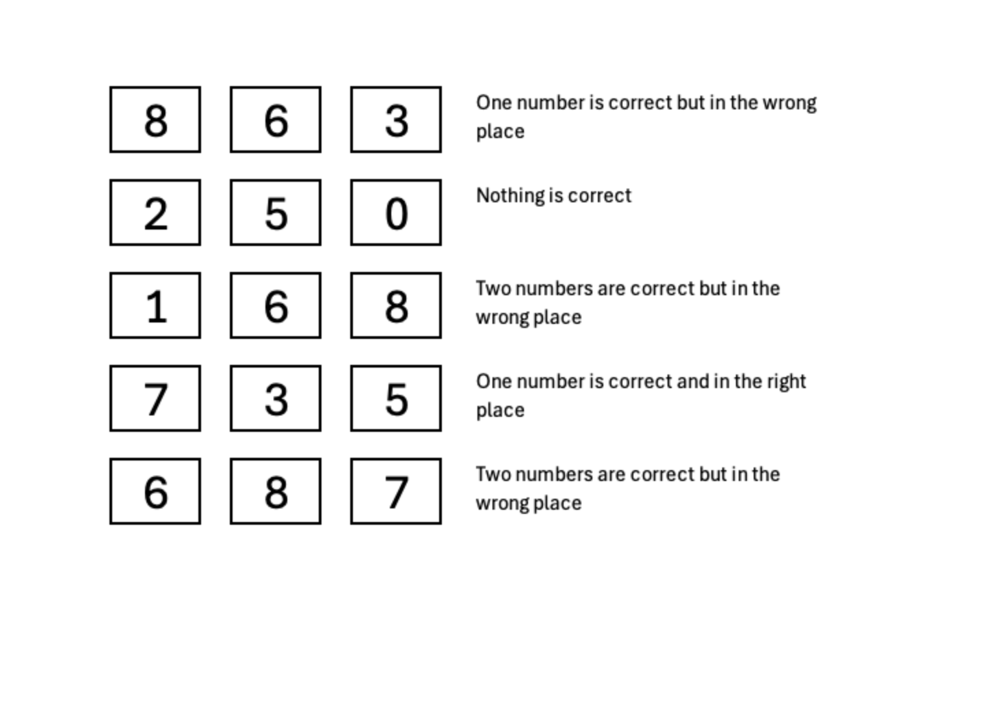

# DECODE-DLE

Reto de **Crypto** del DEADFACE CTF 2024 (autor @G2Gh0st). En realidad es un **puzzle de lógica tipo Mastermind** ("crack the code"): hay que deducir un código de 3 dígitos a partir de 5 pistas, y el flag es ese código (`deadface{###}`).

## Pistas



```
8 6 3  ->  1 correcto, lugar equivocado
2 5 0  ->  nada correcto
1 6 8  ->  2 correctos, lugar equivocado
7 3 5  ->  1 correcto, lugar correcto
6 8 7  ->  2 correctos, lugar equivocado
```

(El reto traía un "Download File" con un SHA256, pero comprobamos que ese hash no corresponde al código ni al flag — es solo para verificar la integridad del archivo descargado, no hay nada que crackear ahí.)

## La deducción

Lo sacamos razonando pista por pista:

1. **`250` → nada correcto:** descartamos el **2, el 5 y el 0**.
2. **`735` → 1 correcto y bien ubicado:** como el 5 ya se fue, el correcto es el **7 (pos.1)** o el **3 (pos.2)**. Si fuera el 3, la pista `863` tendría al 3 como único correcto y eso descartaría 8 y 6, pero entonces `168` no podría tener *dos* correctos → contradicción. Así que es el **7 en la posición 1**, y el **3 no está**.
3. **`687` → 2 correctos mal ubicados:** el 7 ya está (pos.1) y acá aparece en otra posición → cuenta uno. Entonces exactamente **uno** entre {6, 8} está en el código.
4. **`168` → 2 correctos:** necesita dos de {1, 6, 8}. Si el que estuviera fuera fuera el 6 (y estuviera el 8), el 8 quedaría obligado a la pos.3 y la pista lo muestra justo ahí → sería "bien ubicado", contradiciendo "mal ubicado". Así que el que está es el **6** (y el 8 no).
5. **Posición del 6:** `863` lo muestra en pos.2 como "mal ubicado" → no va en pos.2; la pos.1 ya es el 7 → el **6 va en la pos.3**.
6. **El 1:** `168` necesita dos correctos; ya tenemos el 6, el otro es el **1**, mal ubicado. La pista lo muestra en pos.1 → no va ahí, y la pos.3 ya es el 6 → el **1 va en la pos.2**.

Resultado: **7 1 6**. Lo verificamos contra las 5 pistas y las cumple todas.

## Flag

```
deadface{716}
```

## Script

Para no depender solo del razonamiento a mano, hicimos un script [`solve.py`](./solve.py) que prueba los 1000 códigos (000–999) aplicando las reglas de cada pista y se queda con el único que las cumple. Devuelve `716`.

