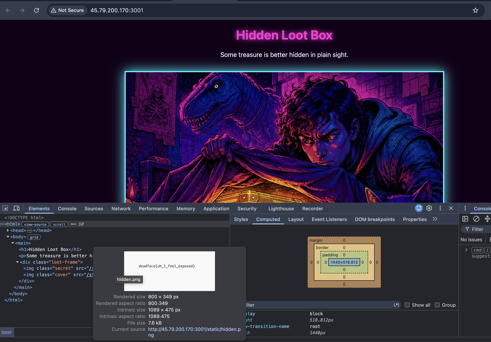

# Hidden Loot Box

Reto de **Steganography / Web** del DEADFACE CTF 2024 (autor @RP-01). La página se llama "Hidden Loot Box" y el enunciado ya tira la pista: *"Never judge a book by its cover. Think you can discover this secret?"*. O sea, hay algo tapado por una "cover".

## Lo que vimos

En el navegador se ve una sola imagen (una caja del tesoro tapada con una tela). Pero mirando el **código fuente** de la página (Ctrl+U / inspeccionar elemento) aparece que en realidad hay **dos imágenes superpuestas**:

```html
<div class="loot-frame">
  
  
</div>
```

El CSS apila la `cover.jpg` **encima** de la `hidden.png`, así que en pantalla solo se ve la de arriba. La de abajo (`hidden.png`) está igual ahí, servida como estático, nada más que tapada visualmente. Es el "hidden in plain sight" literal que menciona el reto.

## La resolución

No hay que hacer estego de verdad (ni LSB ni nada): la imagen "secreta" es un archivo estático común. Alcanza con **abrirla directamente** por su URL (que sacamos del `src` en el HTML):

```
http://45.79.200.170:3001/static/hidden.png
```

Esa imagen es un fondo blanco con el flag escrito:

```
deadface{uh_I_feel_exposed}
```



## Flag

```
deadface{uh_I_feel_exposed}
```

El script [`solve.py`](./solve.py) automatiza la descarga y extracción del flag.

## Nota

La "estego" acá es puro apilado de capas en el front: el archivo sensible está publicado en `/static/` y solo se oculta poniéndole otra imagen encima. Cualquiera que mire el HTML (o liste `/static/`) lo encuentra. Moraleja: tapar algo en el frontend no lo protege — si el recurso está servido, es accesible.

